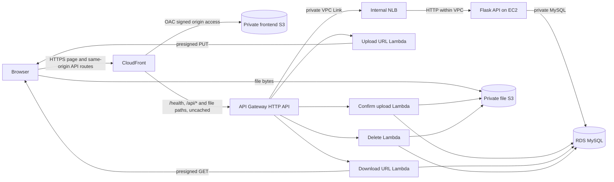

# CloudBox architecture

## Target design

The deployed browser uses the CloudFront URL for both API base URLs, keeping requests same-origin. CloudFront forwards all API paths to API Gateway over HTTPS, with caching disabled. API Gateway invokes file-operation Lambdas and reaches Flask through a private VPC Link and internal NLB. EC2 has no public inbound rule; only the NLB security group can reach its HTTP listener. The NLB-to-EC2 hop uses HTTP inside the VPC. Never place AWS credentials in frontend configuration. Frontend assets and file objects belong in separate private buckets. CloudFront accesses only the frontend bucket through Origin Access Control (OAC). The diagram describes the intended deployment, not a live CloudBox topology.

## Service responsibilities

- **CloudFront:** HTTPS delivery and caching for static assets; OAC protects the frontend S3 origin.
- **Frontend S3:** HTML, CSS, and JavaScript only; no user-uploaded files.
- **File S3:** private user objects, server-side encryption, Block Public Access, short-lived presigned access.
- **EC2 / Flask:** database-backed health, dashboard, listing, and search endpoints.
- **RDS MySQL:** durable file metadata, private subnets, no public access.
- **API Gateway:** four HTTP routes invoking purpose-specific Lambda handlers plus a private VPC Link integration for Flask routes.
- **Internal NLB:** private HTTP forwarding from API Gateway VPC Link ENIs to the EC2 Flask host.
- **Lambda:** issue presigned links, verify uploads, read download metadata, and delete object plus row.
- **Database bootstrap Lambda:** private CloudFormation-only initializer that creates the schema and least-privilege DB user using the RDS master secret, then retains database contents on application-stack deletion.
- **IAM roles:** EC2, the four file-operation Lambdas, and the database bootstrap Lambda use separate role credentials scoped to their purpose; no long-lived AWS credentials are stored in code.

## Frontend and Flask

The static frontend keeps environment-specific endpoints in `frontend/js/config.js`. Flask returns JSON envelopes and reads MySQL through parameterized statements. `/health` checks database connectivity; `/api/*` can require a bearer token. CORS is limited to configured frontend origins. The production server must use Gunicorn or another WSGI server, not Flask's built-in server.

## Database

`cloudbox_db.files` stores an integer ID, original filename, unique S3 key, byte size, MIME type, active status, and UTC upload timestamp. The S3 key is an opaque UUID under `uploads/`; the original filename is metadata only. See [database.md](database.md). The RDS database should be reachable only from the EC2 and Lambda security groups.

## Lambda organization

Each handler lives in its own package directory under `lambda/`; `lambda/common/` contains reusable validation, auth, response, database, Secrets Manager, and S3 helpers. The Lambda bundle must include all of `lambda/` so imports from `common` resolve. Each file handler has its own execution role: upload URL can write only within `uploads/` and read the auth secret; confirmation can inspect/delete objects in that prefix and read the DB/auth secrets; download can read objects and the DB/auth secrets; delete can inspect/delete objects and read the DB/auth secrets. Lambda uses its execution role and is placed in the VPC for private RDS access. A Secrets Manager VPC endpoint or another deliberate network path is needed if its subnet has no NAT and it reads secrets at runtime.

## File workflows

### Upload

1. Browser requests a short-lived PUT link with filename, MIME type, and size.
2. Lambda accepts only allowed extensions and files no larger than 25 MiB, then creates a UUID object key.
3. Browser PUTs directly to private S3 with the signed content type and reports progress.
4. Browser submits the generated key and metadata to confirmation.
5. Lambda validates the key shape, HEADs the object, checks actual size/type, and records metadata. Duplicate confirmation uses the schema's unique-key constraint and returns the existing ID.

The 25 MiB limit bounds demo storage and keeps browser uploads simple; larger files need a multipart-upload flow and corresponding controls.

### Download

Browser supplies a database file ID, never an S3 key. Lambda loads an active metadata record, HEADs the referenced object, and returns a five-minute signed GET URL with the original filename as the download name.

### Delete and partial failures

Lambda looks up the file ID, deletes its S3 object, and then deletes its DB row. S3 delete is idempotent, so retrying after a database failure can complete row cleanup. If the DB is unavailable after S3 deletion, the request reports service unavailable and the row may temporarily point to a missing object; an operator can retry or reconcile. There is no distributed transaction spanning S3 and MySQL.

## Network and security

RDS is private and accepts MySQL only from application security groups. Lambda needs VPC subnets and security-group access to RDS; avoid a NAT Gateway where feasible, but account for endpoint costs and access to Secrets Manager. The internal NLB and VPC Link also have usage/hourly costs. All S3 buckets have Block Public Access, encryption, and bucket policies that deny non-TLS requests; the file bucket CORS rule permits only the two local development origins and the exact CloudFront origin. The deployment script sets that origin in a follow-up stack update after CloudFront returns its generated hostname, avoiding a dependency cycle without a wildcard. Presigned URLs remain the authorization mechanism, not CORS. API Gateway CORS allows local origins during development; deployed CloudFront requests use the same origin. Auth token demo mode is single-user and not a replacement for Cognito or a full identity system.

## Deployment state

AWS target region is `ap-southeast-2`. At the latest read-only check, the connected IAM user had EC2, RDS, and S3 full-access policies attached, but policy simulation showed organization-level explicit denies on CloudFormation and key resource-creation operations; IAM role creation and CloudFront distribution creation were also not allowed. No CloudBox resources were created or deployed. See `deployment/README.md` and `docs/testing_report.md` for the exact current status.
